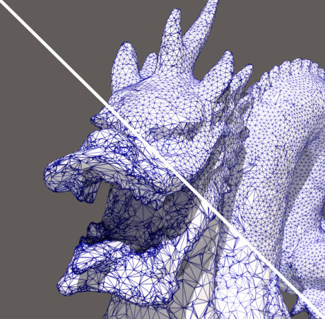
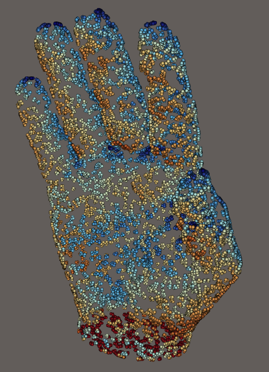
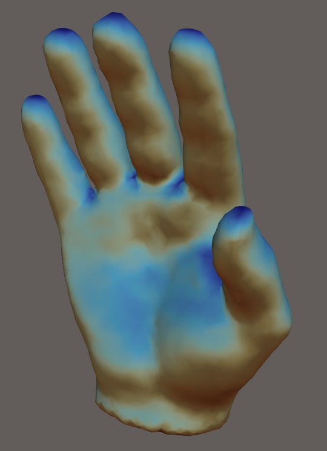
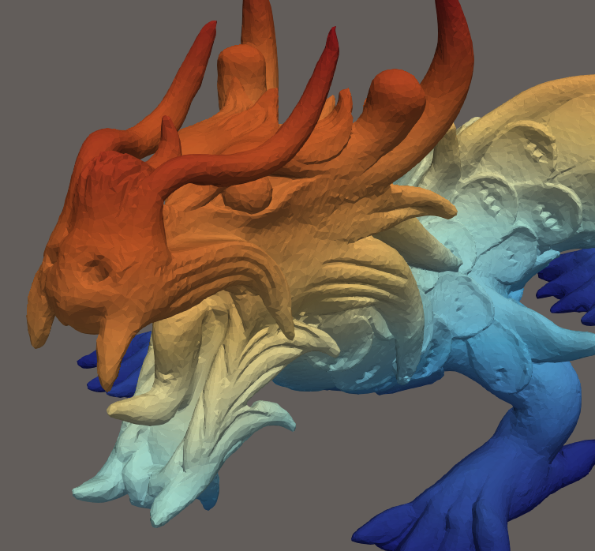
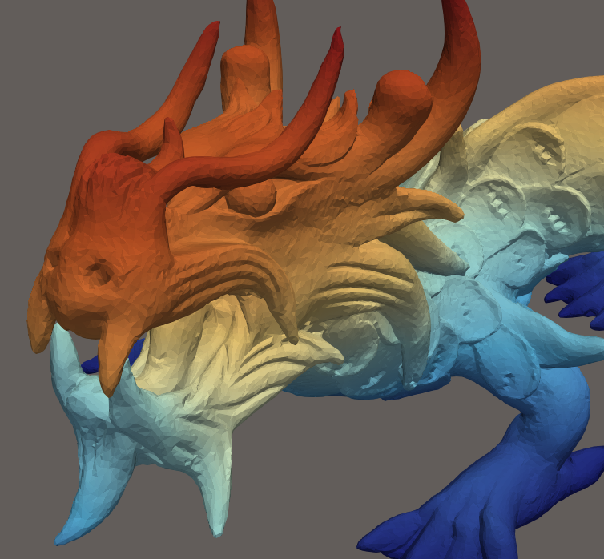

<!-- README.md is generated from README.Rmd. Please edit that file -->

```{r setup, include = FALSE}
knitr::opts_chunk$set(
  collapse = TRUE,
  comment = "#>",
  eval = FALSE
)
```

# vespa — VTK Enhanced with Surface Processing Algorithms

<!-- badges: start -->
[](https://github.com/cregouby/vespa/actions)
[](https://lifecycle.r-lib.org/articles/stages.html#experimental)
[](https://CRAN.R-project.org/package=vespa)

[](https://CRAN.R-project.org/package=vespa)
<!-- badges: end -->

**vespa** is an R package providing bindings to the
[VESPA](https://gitlab.kitware.com/vtk/meshing/vespa) C++/VTK/CGAL mesh
processing library. It exposes CGAL geometry and surface processing
algorithms as R functions operating on `mesh3d` objects (package
[rgl](https://cran.r-project.org/package=rgl)).



*Isotropic remeshing of a surface mesh*

```{r isotropic-remeshing}
library(vespa)
mesh <- read_stl(system.file("extdata", "torus.stl", package = "vespa"))
remesh <- isotropic_remeshing(mesh, target_length = 0.1, n_iterations = 3L)
rgl::shade3d(remesh, col = "steelblue")
```

*Surface reconstruction from a point cloud*

<table>
<tr>
<td align="center"><br/><em>input cloud</em></td>
<td align="center"><br/><em>reconstructed mesh</em></td>
</tr>
</table>

```{r surface-reconstruction}
library(vespa)
pts <- read_points_xyz(system.file(
  "testdata",
  "test_points.xyz",
  package = "vespa"
))
pts <- pca_estimate_normals(pts, n_neighbors = 18L, orient = TRUE)
recon <- poisson_reconstruction(pts)
rgl::shade3d(recon, col = "tomato")
```

*As-Rigid-As-Possible mesh deformation*

<table>
<tr>
<td align="center"><br/><em>original</em></td>
<td align="center"><br/><em>deformed</em></td>
</tr>
</table>

```{r mesh-deformation}
library(vespa)
mesh <- read_stl(system.file("extdata", "torus.stl", package = "vespa"))

n <- ncol(mesh$vb)
fixed <- which(mesh$vb[3, ] < -0.25) # bottom ring — fixed handles
moved <- which(mesh$vb[3, ] > 0.25) # top ring    — pulled up
target <- mesh$vb[1:3, moved, drop = FALSE]
target[3, ] <- target[3, ] + 0.4 # translate +0.4 along Z

deformed <- mesh_deformation(
  mesh,
  control_ids = c(fixed, moved),
  target_coords = cbind(mesh$vb[1:3, fixed], target),
  roi_ids = seq_len(n)
)
rgl::shade3d(deformed, col = "goldenrod")
```

## Installation

### Prerequisites

The package requires CGAL (>= 5.5), Ceres Solver (>= 2.0), Eigen (>= 3.2), and Boost headers. Install them with your software package manager.<br>
VTK (>= 9.4) is provided by the [rvtk](https://cran.r-project.org/package=rvtk) package, which uses a system installation when available and otherwise supplies pre-built static libraries.<br>
The Vespa C++ sources are bundled with the package and compiled at install time; no separate Vespa installation or network access is required.

### R package installation

```r
install.packages("vespa")
```

You can install the development version from GitHub with:

```r
# install.packages("pak")
pak::pak("cregouby/vespa")
```

## Installation (local development version)

<details>
  <summary>Click for detailed installation procedure</summary><p>

### R package installation step by step

```sh
git clone git@github.com:cregouby/vespa.git
cd vespa
R CMD INSTALL .
```

The bundled Vespa sources are used automatically. Advanced users can instead
point `VESPA_ROOT` at an existing Vespa installation before running
`R CMD INSTALL`.

</p></details>

## Usage notes

::: {.callout-tip}

All {vespa} filters expect a <br>
 - **triangulated**,<br>
 - **watertight**,<br>
 - **2-manifold** surface represented as a `mesh3d` object.

Use `mesh_check()` to diagnose topological issues and potentially fix watertight issues.<br>
Use `alpha_wrapping()` to repair a mesh that is not watertight or 2-manifold.

:::


## License

This package is distributed under a BSD-3 license. Because it links to
CGAL, any binary built from it retains the GPLv3 license unless you hold
a commercial license from
[GeometryFactory](https://geometryfactory.com/).
